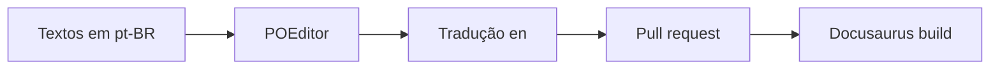

# POEditor — quando e como usar

:::warning[Escopo atual]
Hoje o `Portal Dev` e os projetos da `elizfab` são **monolíngues em pt-BR**. POEditor só deve ser
ativado se você decidir oferecer conteúdo em inglês ou outro idioma.
:::

## O que é

POEditor é uma plataforma de gerenciamento de traduções (TMS). Ela centraliza strings de texto,
permite traduzir e exportar de volta para arquivos JSON, MDX, po, xliff etc.

A URL [https://poeditor.com/register/github_education](https://poeditor.com/register/github_education)
permite resgatar o **plano Plus grátis por 1 ano** via GitHub Student Developer Pack.

## Onde encaixaria no Docusaurus

Hoje o Docusaurus tem apenas:

```ts title="docusaurus.config.ts"
i18n: {
  defaultLocale: 'pt-BR',
  locales: ['pt-BR'],
}
```

Se adicionar outro idioma, seria necessário:

1. Ativar `locales: ['pt-BR', 'en']`.
2. Criar `i18n/en/code.json` para strings da UI.
3. Criar `i18n/en/docusaurus-plugin-content-docs/current/...` para os conteúdos.

POEditor poderia gerar os arquivos do passo 2 e ajudar a rastrear as traduções.

## Fluxo sugerido (futuro)



## Quando ativar

Ative POEditor somente se:

- [ ] Houver decisão de oferecer conteúdo em outro idioma.
- [ ] O site já estiver estável e com boa parte do conteúdo escrito.
- [ ] Você tiver tempo para revisar as traduções (automáticas ou humanas).

## Checklist de configuração (guardado para depois)

1. Criar conta em POEditor com login GitHub (via Student Pack).
2. Criar projeto com `pt-BR` como língua de origem.
3. Adicionar `en` (ou outra) como língua alvo.
4. Importar `frontend/i18n/pt-BR/code.json`.
5. Traduzir strings e exportar para `frontend/i18n/en/code.json`.
6. Ativar `en` no `docusaurus.config.ts`.
7. Rodar `npm run build` e `npm run serve` para validar.
