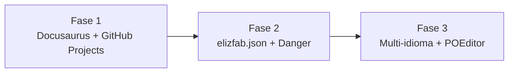

# Ferramentas de gestão

A pergunta original foi: "POEditor consegue nos ajudar com esse projeto?".

A resposta curta: **não para o objetivo de mapear projetos**. POEditor é uma ferramenta de
tradução (i18n), não de gestão de conhecimento ou portfólio. Para organizar tudo, o conjunto abaixo
é mais adequado.

## Mapa de ferramentas

| Objetivo | Ferramenta correta | Por quê |
| --- | --- | --- |
| Manual de consulta | **Docusaurus** (este portal) | Páginas em MDX, busca, categorias |
| Tarefas e roadmap | **GitHub Projects** ([Project 2](https://github.com/orgs/elizfab/projects/2)) | Kanban ligado a issues e PRs |
| Código e versionamento | **GitHub** (`elizfab/*`) | Repositórios, actions, releases |
| Padrões de repositório | **Danger + `elizfab.json`** | Verifica README, branch, lockfile etc |
| Tradução de interfaces | **POEditor** | Só se houver multi-idioma |
| Notas rápidas pessoais | **Obsidian / Notion** (opcional) | Rascunhos fora do repositório |

## Quando POEditor entra no radar

POEditor só vale a pena se você planeja:

- ter o site em **mais de um idioma** (ex.: pt-BR + en);
- traduzir textos da UI de algum app (`code.json`, labels, modais);
- terceirizar revisão de tradução.

O `Portal Dev` hoje está em **pt-BR apenas**. Portanto, POEditor é **opcional e futuro**.

## Pilha recomendada por fase

| Fase | Foco | Ferramenta principal |
| --- | --- | --- |
| 1 | Mapear e consultar | Docusaurus + GitHub Projects |
| 2 | Padronizar criação | `elizfab.json` + Danger |
| 3 | Traduzir conteúdo | POEditor (somente se necessário) |

:::info[Recomendação]
Não adicione POEditor agora. Primeiro consolide a estrutura de documentação e o mapeamento dos
projetos existentes. Tradução é um problema do futuro, não do início.
:::
