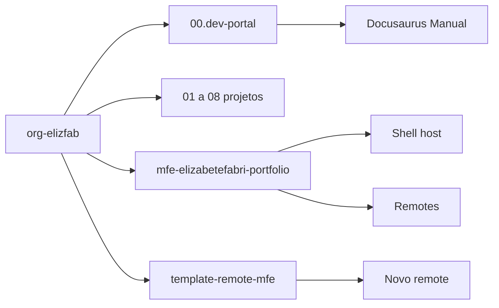

<TechIcon icon="devicon/devicon-original" alt="Gestão de projetos" />

Este espaço guarda o **mapa de todos os projetos** da organização `elizfab`, os padrões usados
para documentá-los e as ferramentas que ajudam nesse processo.

:::info[Propósito]
Manter o portfólio organizado desde o início: saber onde cada projeto mora, qual é o escopo,
quais são os links, imagens e comandos, e como adicionar um novo projeto sem repetir a mesma
estrutura manualmente.
:::

## O que você encontra aqui

<DocCardList />

## Visão rápida

